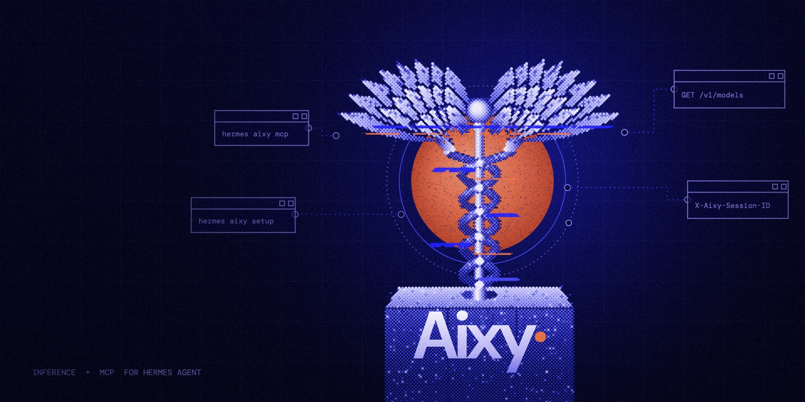

# Aixy for Hermes



**Run [Hermes Agent](https://github.com/NousResearch/hermes-agent) through [Aixy](https://aixy-gateway.com): guided inference setup, plus optional MCP tools.**

Setup points a Hermes profile at your Aixy gateway and lets you choose a model from its catalog.
Model requests carry Hermes' conversation ID, so Aixy Activity can group them by session. Aixy MCP
tools through browser OAuth are a separate, explicit choice.

[Install](#install) · [Optional MCP](#optional-mcp) · [What setup changes](#what-setup-changes) ·
[Aixy](https://aixy-gateway.com)

Requires Hermes 0.22.5+ and an interactive terminal.

## Install

1. Install and enable the plugin:

   ```bash
   hermes plugins install aixy-tech/aixy-hermes-plugin --enable
   ```

2. Run the guided setup:

   ```bash
   hermes aixy setup
   ```

3. Enter your gateway, project API key (hidden), and model. Hermes manages context automatically.
4. Confirm to make Aixy your default provider, then start a new Hermes session.

For routes Hermes cannot identify, `--context-length <tokens>` lets you set a known limit.

## Optional MCP

Setup offers to connect MCP through browser OAuth. The default is **No**. To connect it later:

```bash
hermes aixy mcp
```

Choose your tools, then start a new Hermes session.

## What setup changes

- **Profile.** Setup reads and updates the selected Hermes profile.
- **Network.** It fetches your gateway's model catalog using the project key. It sends no
  inference requests.
- **Credentials.** The project key is stored through Hermes.
- **Requests.** Model requests carry Hermes' conversation ID in `X-Aixy-Session-ID` so Activity can
  group them.
- **MCP, only if you opt in.** Setup launches Hermes' native CLI with the selected profile and
  process environment, with unattended and YOLO flags disabled. It contacts your MCP endpoint and
  OAuth service and saves the connection settings and credentials through Hermes. Normal tool
  approvals remain in place.
- **Nothing else.** The plugin only adds the `hermes aixy` commands: no hooks, no runtime tools, no
  separate telemetry or background services. Loading it never reads credentials, changes
  configuration, or connects to a service.

## More

[Native contract checks](tests/native/README.md) · [MIT license](LICENSE)
